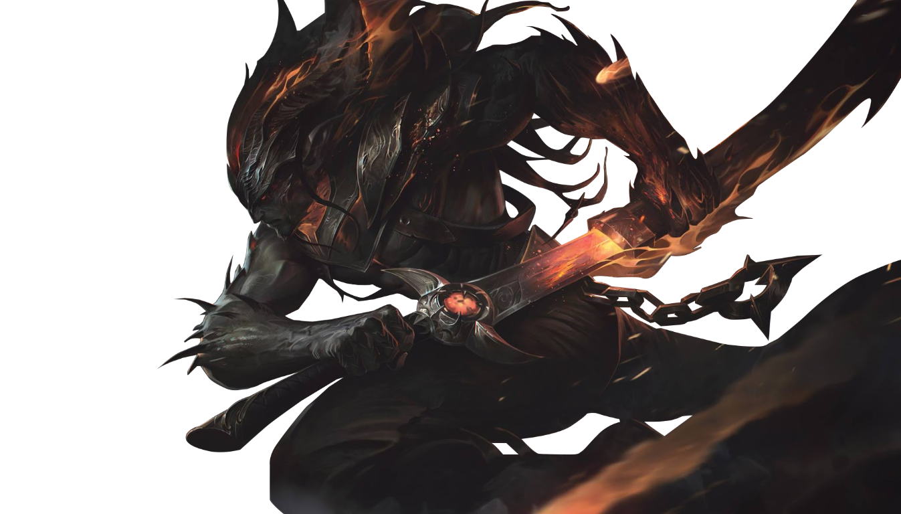

<div align="center">
  
  <h1>Bronx I.A</h1>
  <p><strong>O companion de League of Legends focado no jungler.</strong></p>
  <p>Posição observada no minimapa, contexto de objetivos e histórico ranqueado em uma interface desktop.</p>
</div>

---

## Acompanhe o que importa

O Bronx I.A combina dados locais da partida com leitura visual do
minimapa para destacar o jungler adversário. A proposta é manter a tela
centrada no que acontece na selva: sem alertas de desaparecimento de top,
mid ou bot. Quando o jungler deixa de ser detectado, o overlay marca com `?`
o último ponto observado no minimapa e informa a região por voz e na tela.
Na tela inicial, os atalhos levam à partida e ao calendário, com destaque para
a IA de detecção de jungler ainda em desenvolvimento.

| Recurso | O que faz |
| --- | --- |
| **Rastreamento do jungler** | Identifica apenas o jungler pela posição informada na partida ou pelo feitiço Golpear e procura somente o retrato dele no minimapa. Os outros jogadores não são rastreados. |
| **Posição observada** | Mostra as regiões, acampamentos e covis de objetivo onde o ícone do jungler é confirmado em leituras consecutivas, mesmo quando ele está se movendo. |
| **Última posição observada** | Após duas leituras consecutivas sem detectar o jungler, exibe um `?` no ponto em que ele foi visto pela última vez e avisa na tela e por voz. O marcador é removido quando ele volta a ser detectado. |
| **Contexto de gank** | Ao detectar o jungler numa rota, sinaliza uma possibilidade — nunca afirma que um gank vai acontecer. |
| **Flash Timing** | Durante a captura, lê o chat da partida em busca de marcações de Flash de qualquer campeão inimigo no formato exibido pelo jogo, sem depender da função ou do jungler rastreado. Mostra o campeão, o ícone do Flash e a recarga fixa de 300 segundos no painel próprio e no overlay. O tempo acompanha o cronômetro da partida. |
| **Objetivos** | Usa o cronômetro para alertar sobre Vastilarvas, Arauto (14:30/15:00) e Barão (19:00/20:00). O full clear usa o melhor tempo registrado para o jungler inimigo na patch mais recente da planilha de clears. São previsões, não confirmações de conclusão de acampamentos ou surgimento real do objetivo. |
| **Calendário ranqueado** | Importa partidas solo ranqueadas automaticamente e reúne resultados e snapshots de elo/PDL. |
| **Voz local** | Faber e Jeff originais do Piper pt-BR, Alba e Azelma do Pocket TTS em português ou vozes instaladas no Windows. Os modelos são baixados na primeira prévia e depois ficam em cache local. A síntese e o texto dos alertas permanecem no dispositivo. |

### Vozes Pocket TTS

As vozes Alba e Azelma usam o pacote
[pocket-tts-js](https://github.com/vlapky/pocket-tts-js) (MIT) e o bundle ONNX em português de
[vlapky/pocket-tts-onnx](https://huggingface.co/vlapky/pocket-tts-onnx), cuja
licença publicada é CC BY 4.0. Os créditos e atribuições aplicáveis às vozes
devem acompanhar os respectivos dados e a licença do bundle; consulte também
o projeto original [Kyutai Pocket TTS](https://github.com/kyutai-labs/pocket-tts).

A primeira prévia pode baixar cerca de 180 MB de modelos e dados de voz do
Hugging Face. Esses são arquivos públicos gratuitos; não há serviço pago de
síntese. O runtime ONNX Web acompanha o aplicativo e o texto dos alertas é
processado localmente. Os arquivos de voz ficam no cache local do aplicativo
para uso posterior offline. A conexão é necessária na primeira configuração.

> **Em desenvolvimento:** a leitura do minimapa usa o retrato do campeão e
> regiões geométricas aproximadas. Escala, qualidade de imagem e ícones
> sobrepostos podem causar falhas. O marcador representa somente a última
> posição visualmente confirmada; não estima movimentos ou posições ocultas.

Os itens **Wireless Champion Select** e **Sugestão de Pick** na navegação são
apenas espaços reservados para futuras funcionalidades e permanecem desativados.

## Instalação e execução no Windows

Este guia é para executar o projeto a partir do código-fonte. Você precisa de
Windows, Git, Node.js 22.12 ou superior (recomendado: Node.js LTS), npm e
internet durante a instalação. O Worker da Riot é opcional; só é necessário
para habilitar a sincronização do calendário.

### Primeira instalação

1. Instale o Git e o Node.js LTS. Feche e abra novamente o PowerShell depois
   da instalação do Node.js.
2. Clone o repositório e entre na pasta do projeto:

   ```powershell
   git clone https://github.com/leandrotominay/bronxAnalytics.git
   cd .\bronxAnalytics
   ```

3. Confirme que o PowerShell encontra Node.js e npm:

   ```powershell
   node --version
   npm --version
   ```

   O Node.js deve ser `v22.12.0` ou superior. Se `node` ou `npm` não forem
   reconhecidos, instale o Node.js LTS e abra um novo PowerShell.

4. Instale os pacotes do projeto:

   ```powershell
   npm install
   ```

5. Baixe o runtime do Electron, necessário para abrir o aplicativo:

   ```powershell
   npx install-electron --no
   ```

   Aguarde o comando terminar. Confirme que o executável foi instalado:

   ```powershell
   Test-Path .\node_modules\electron\dist\electron.exe
   ```

   Prossiga somente se o resultado for `True`. Se for `False`, o runtime não
   foi baixado: repita `npx install-electron --no` e confira o erro exibido.
   O download pode ser bloqueado por falta de internet, proxy ou firewall.

6. Inicie o aplicativo:

   ```powershell
   npm run dev
   ```

   A janela do Bronx I.A deve abrir. Mantenha essa janela do PowerShell aberta
   enquanto usa o app; `Ctrl+C` encerra o processo de desenvolvimento.

### Executar novamente depois da instalação

Abra o PowerShell, entre na pasta clonada do projeto e execute:

```powershell
cd .\bronxAnalytics
npm run dev
```

Não é necessário repetir `npm install` nem baixar o runtime do Electron a cada
execução. Se trocar de computador ou apagar `node_modules`, repita os passos 4
e 5 da primeira instalação.

### Problemas comuns ao iniciar

- **`Error: Electron uninstall`:** o runtime não está instalado. Na pasta do
  projeto, execute `npx install-electron --no` e confirme que
  `Test-Path .\node_modules\electron\dist\electron.exe` retorna `True` antes
  de tentar `npm run dev` novamente.
- **O download falha ou o executável continua ausente:** confira a conexão,
  proxy ou firewall e leia a mensagem completa de `npx install-electron --no`.
  O aviso `allow-scripts` do npm é separado: `npm approve-scripts
  --allow-scripts-pending` apenas lista scripts pendentes; não instala o
  runtime do Electron.
- **`node` ou `npm` não são reconhecidos:** instale Node.js LTS e reinicie o
  PowerShell para atualizar o `PATH`.

Para verificar os tipos e compilar sem abrir o app:

```powershell
npm run typecheck
npm run build
```

Esses comandos não substituem os passos 5 e 6: uma compilação bem-sucedida não
confirma que o runtime do Electron foi baixado nem que o app abriu.

Quem só quer usar o aplicativo, sem executar o código-fonte, precisa do
instalador `.exe`; veja [Gerar o instalador](#gerar-o-instalador-windows).
Não é necessário instalar Node.js, npm ou Git no computador de quem instala
esse `.exe`.

### Gerar o instalador Windows

Para criar o instalador `.exe`, na pasta do projeto execute:

```powershell
npm run dist:win
```

O instalador NSIS será gerado em `release/`. Ele instala o mesmo app Electron
usado em desenvolvimento; o formato do instalador não reduz o uso de CPU ou
memória durante a partida. O Worker Cloudflare continua sendo um serviço
separado. A URL do Worker só precisa ser configurada antes da compilação se
você quiser habilitar a sincronização do calendário; veja a seção
[Calendário e Riot ID](#calendário-e-riot-id).

Abra o League of Legends e entre em uma partida. O app procura a janela do
jogo; pressione **Iniciar** para autorizar a captura visível. A captura
e a análise do minimapa acontecem localmente, e a captura termina pelo botão
**Encerrar**.

## Calendário e Riot ID

Na página **Calendário**, informe seu Riot ID (`Nome#TAG`) e plataforma. O app
consulta partidas ranqueadas pela API oficial da Riot por meio do serviço de
sincronização do Bronx; não é necessário informar um endereço de Worker. O
aplicativo não pede senha da Riot.

Cada consulta busca até 20 partidas solo ranqueadas para respeitar os limites
da API da Riot. Se houver mais histórico, use **Carregar partidas anteriores**
para buscar páginas mais antigas. Selecione um dia no calendário para expandir
os jogos daquela data, com campeão, horário, duração, K/D/A, KDA, CS, ouro e
dano a campeões. Os filtros semanal, mensal e anual alternam a escala do
calendário; na visão anual, selecione um mês para detalhá-lo.

O PDL exibido como saldo diário e do período é uma estimativa configurável:
informe o PDL ganho por vitória e o perdido por derrota; remakes não entram na
conta. O ganho real varia por partida e a Riot não fornece esse valor no
histórico. Variações individuais só são exibidas quando podem ser observadas
por snapshots de elo.
Após uma sincronização bem-sucedida, o perfil mostra o Riot ID conectado e um
botão **Desconectar**. Desconectar remove o vínculo e mantém o histórico local.

O app não inclui uma chave Riot. Para habilitar sincronização:

1. Crie uma chave de desenvolvimento no [Riot Developer Portal](https://developer.riotgames.com/).
2. Configure o Worker em `workers/riot-sync`; para desenvolvimento local, crie
   `workers/riot-sync/.dev.vars` com `RIOT_API_KEY=<sua-chave>`.
3. Execute `npm run worker:dev` para testar localmente ou faça login no
   Cloudflare, configure `RIOT_API_KEY` como secret e publique com
   `npm run worker:deploy`.
4. Ao criar uma versão distribuível, defina `BRONX_RIOT_SYNC_URL` como a URL
   HTTPS do Worker antes de executar `npm run dist:win`. No PowerShell:

   ```powershell
   $env:BRONX_RIOT_SYNC_URL = 'https://seu-worker.workers.dev'
   npm run dist:win
   ```

   O endereço fica configurado na versão do app, não é solicitado aos jogadores
   e não é um segredo. Uma compilação de distribuição sem essa variável não terá
   sincronização habilitada. Em desenvolvimento, o app usa
   `http://localhost:8787` quando a variável não está definida.

Chaves de desenvolvimento expiram e não servem para uma distribuição pública.
Antes de publicar o produto, siga os requisitos de registro e aprovação da
Riot. Nunca coloque uma chave em arquivos do renderer, preload, builds ou no
repositório.

A API de partidas não fornece o PDL histórico de cada jogo. O calendário só
associa uma variação de PDL quando existem snapshots observados antes e depois
da partida, sob as condições de consistência implementadas. Quando não há
dados suficientes, a variação fica indisponível em vez de ser estimada.
O elo é exibido em texto; emblemas ranqueados só serão adicionados a partir de
uma fonte de assets autorizada pela Riot.

## Privacidade e limites

- Frames de jogo e dados da API local ficam no dispositivo; imagens só são
  exportadas quando você solicita uma amostra diagnóstica.
- O Riot ID e a plataforma são enviados ao serviço de sincronização configurado
  para a consulta.
  A chave da Riot permanece como secret do Worker, fora do aplicativo desktop.
- A detecção visual é experimental e reporta apenas sinais observáveis na tela.
  Ela não lê memória, não injeta código no cliente e não automatiza gameplay.
- Diagnósticos e ajustes do minimapa ficam disponíveis no modo desenvolvedor.

O uso da API local e a distribuição do produto estão sujeitos às políticas
atuais da Riot Games. Bronx I.A não é endossado pela Riot Games e não
reflete as opiniões da Riot Games nem de qualquer pessoa oficialmente
envolvida na produção ou gestão de propriedades da Riot Games. Riot Games e
todas as propriedades associadas são marcas comerciais ou marcas registradas
da Riot Games, Inc.

## Tecnologias e referências

- Electron, TypeScript e Vite
- [Documentação das APIs de League of Legends](https://developer.riotgames.com/docs/lol)
- [Políticas para desenvolvedores Riot](https://developer.riotgames.com/policies/general)
- [Piper — vozes pt-BR](https://huggingface.co/rhasspy/piper-voices)

---

<div align="center">
  <sub>Construído para manter o foco na selva. Posição observada, não adivinhada.</sub>
</div>
